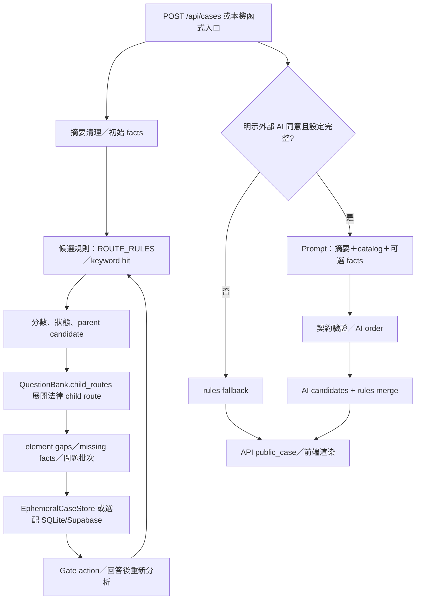

# LEGAL_ROOT_CAUSE_AUDIT

> 任務：LEGAL-ROOT-CAUSE-001  
> 稽核日期：2026-10-28（Asia/Taipei）  
> execution mode：`SINGLE_EXECUTOR`；runtime model identity：`UNVERIFIED`  
> 範圍：唯讀程式／Prompt／規則／schema／migration／查詢／測試稽核。唯一新增檔案為本報告。

## 1. 結論摘要

**結論：`PARTIAL_PASS`。**

已完成目前工作樹的靜態流程、候選規則、Prompt、儲存 schema、版本控制與輸出映射稽核，並對兩條本機規則路徑做了不連線的函式級重播。稽核中途曾觀察到 `criminal-investigation-assistant/app/domain.py:196` 的 `IndentationError`，但最後讀取與 compile 時檔案已變更並可執行；這是工作樹狀態漂移，不宣稱由本輪造成。外部 LLM／正式資料庫／雲端均依指令未連線，沒有安全隔離 DB 可供本輪 C 測試。

### 根因分類判定

| 分類 | 判定 | 證據與信心 |
|---|---|---|
| `RULE_OR_RANKING` | **已確認存在的高風險機制** | `criminal-investigation-assistant/app/domain.py:398-405, 429-435` 以 parent keyword hit 加權；`遺留／失主／拾得` 在目前 `ROUTE_RULES` 的 embezzlement parent trigger（line 21），並以文字分數直接決定 `CANDIDATE`／`NEEDS_FACTS`。信心 0.95。 |
| `FACT_EXTRACTION` | **部分已確認，尚非本案輸出根因** | `extract_facts` 將整段摘要保存為 `NARRATIVE`，人物 token 為 `INFERENCE`，持有／主觀意圖／證據為 `UNKNOWN`（`domain.py:269-290`）；目前沒有證據顯示「乙的辯解」被改寫成客觀已脫離持有。信心 0.75。 |
| `PIPELINE_LOGIC` | **可能** | parent candidate 先建立，再由 `QuestionBank.child_routes` 展開所有 child route；沒有看到 child route 專屬 score／gate（`domain.py:406-424`、`question_bank.py:75-106`）。這可使 parent 的文字命中外溢到第337條，但缺少可執行重播證據。信心 0.80。 |
| `LLM_OR_PROMPT` | **目前不支持為本案根因** | `legal-case-web` 的外部 AI 預設受 `ALLOW_EXTERNAL_AI` 與 API key 雙重限制（`app/ai.py:60-75`）；Prompt 明定只能依摘要、缺口放入 `missing`（`app/ai.py:125-170`）。沒有送出或回應 log，不能證明模型造成已知偏差。信心 0.90（排除程度）。 |
| `DATABASE_WRITE_READ` | **目前不支持為本案根因** | `criminal-investigation-assistant` 有 revision/parent revision/CAS/immutable schema（`app/storage.py:63-117, 387-461`），但 runtime 不能 import，且本輪不連接現有 DB；`legal-case-web` 預設為 `EphemeralCaseStore`（`app/server.py:83-90`）。信心 0.80（排除程度）。 |
| `RETRIEVAL_OR_CACHE` | **目前不支持為本案根因** | 法律 retrieval cache 僅保存官方 metadata/hash，拒絕案情 payload，且文件明示未接入 Gate 2（`legal-case-web/app/legal_retrieval_cache.py:1-5, 128-220`）。沒有實際檢索結果或 cache hit log。信心 0.85（排除程度）。 |
| `OUTPUT_MAPPING` | **存在顯示差異風險，但未證明造成第337條** | `legal-case-web/app/static/app.js:387-392` 過濾 `selection_origin === related_hint`，可能隱藏關聯候選；正式候選列表仍依 bank 順序渲染（`app.js:514-539`）。沒有證據顯示該過濾把第337條從 NEEDS_FACTS 改成 CANDIDATE。信心 0.65。 |

因此，**已知「第337條 CANDIDATE、320條 NEEDS_FACTS」這個具體輸出，在目前工作樹尚未被重現；不可把 `RULE_OR_RANKING` 靜態風險直接升級為已知輸出的唯一根因。** 最保守結論是：`MULTIPLE_CAUSES` 尚不能確認，整體具體輸出根因為 `UNKNOWN`；但候選偏差的最強已證實機制是 `RULE_OR_RANKING` 加上 parent→child `PIPELINE_LOGIC` 風險。

## 2. 實際系統流程



### 兩個實際 runtime 邊界

1. `legal-case-web`：`server.py:793-800` 的本機分析路徑呼叫 `_local_analysis_payload`；建立案件走 `create_case`，儲存依設定選 `EphemeralCaseStore`、`CaseStore` 或 `SupabaseCaseStore`（`server.py:83-90`）。README 也明示外部 AI 預設關閉、案件候選不是自動定罪。
2. `criminal-investigation-assistant`：`server.py:165-170` → `make_case` → `domain.py:512` → `analyze_candidates`；再由 `RevisionStore.create` 寫入 immutable revision 與 normalized tables。這是另一條 runtime，不能用第一條 runtime 的結果證明第二條輸出。

## 3. 原始案情到候選輸出的追蹤表

| 階段 | 實際資料 | 來源／狀態 | 證據 | 稽核判定 |
|---|---|---|---|---|
| 原始摘要 | 甲放手機、乙拿取離開；乙稱以為遺留／不要；持有與不法所有意圖未確認 | `intake.summary`；整段敘事 | `criminal-investigation-assistant/tests/test_sim_case_remediation.py:13-14` | `FACT`：來源仍是摘要；角色斷言未分離到具體 evidence link |
| 初始人物 | 甲、乙由 token 產生 | `INFERENCE`／`INFERRED_TOKEN` | `domain.py:276-281, 293-315` | `FACT`：有標記，不是客觀身分證明 |
| 初始行為 | 每句摘要成 `UNCONFIRMED_EVENT`，status=`REPORTED` | `INTAKE:summary` | `domain.py:318-324` | `FACT`：報案敘述尚未變成已證實行為 |
| 持有／意圖 | 通用 fact 為 `UNKNOWN`，待問答確認 | `SYSTEM:GATE1` | `domain.py:282-289` | `FACT`：未見直接把乙辯解轉成客觀持有狀態 |
| parent 候選 | `embezzlement` 命中 `遺留／失主／拾得` 等字詞；`theft` 命中拿取／取走類字詞 | `ROUTE_RULES`；文字命中 | `domain.py:15-25, 398-405` | `FACT`：是代理訊號，不是要件證明 |
| child route | parent 命中後列出所有 child route，包含 `embezzlement_337_lost_property` | `QuestionBank.child_routes` | `question_bank.py:75-106`；`routes.snapshot.json:144-150` | `FACT`：child route 展開未由獨立 score 決定 |
| 狀態 | `score >= 65` → `CANDIDATE`；否則 `NEEDS_FACTS`，有 contrary hit 則 `LOWERED` | 門檻與排序 | `domain.py:405, 429-430` | `FACT`：狀態與規則分數直接相連 |
| 排序 | `(-score, candidate_id)` | parent score | `domain.py:485` | `FACT`：無法律要件滿足度排序 |
| 問句 | 最高候選及分差 ≤20 的第二候選進入問句規劃 | `live[:1]`／delta | `domain.py:765-786` | `FACT`：低分候選可被顯示但不必然生成完整問題族 |
| 最終呈現 | UI 依 bank offense order 渲染候選；related hint 可被隱藏 | 前端 map/filter | `legal-case-web/app/static/app.js:387-392, 514-539` | `FACT`：存在內部／畫面清單差異可能 |

**重要限制：**「乙表示以為是遺留物」在目前程式中可作為 `REPORTED`／摘要文字與 embezzlement parent 的 trigger；目前沒有證據顯示它被寫成 `FACT: phone out of possession`。真正問題是 trigger 的法律語義過強，以及 parent hit 對 child route 的外溢風險，而非已證明的事實抽取改寫。

## 4. 候選產生與排序呼叫鏈

### `criminal-investigation-assistant`

```text
POST /api/cases
  → server.py:166 make_case(body, BANK)
  → domain.py:512 analyze_candidates(summary, bank)
  → domain.py:398-405 ROUTE_RULES hit + score
  → domain.py:406-424 child_routes + element_gaps
  → domain.py:429 status / domain.py:440 candidate_role
  → domain.py:485 sorted(-score, candidate_id)
  → domain.py:765-786 question selection
  → storage.py:520-535 case_candidate / element_gap
```

目前規則的具體效果：

- `domain.py:21` 把 `拾得、拾獲、遺失、遺留、失主` 放在 `embezzlement` parent trigger。
- `domain.py:143-155` 對「遺留／失主／拾得」加語意分數，對「誤認／不要的物品」才扣除不法所有意圖線索；它仍沒有把 `reported` 轉成客觀 `out_of_possession`。
- `domain.py:405` 的分數是 `35 + 命中數×15 + 選定加分 - contrary×25 + semantic_adjustment`，不是逐一構成要件的證明計算。
- `domain.py:407-418` 對 parent 命中後取得 child route；`QuestionBank.child_routes` 會按 route id 聚合，故第337條是 parent 的可用 child route，但目前無法從靜態程式直接證明它被單獨排序成第一名。

### `legal-case-web`

```text
POST /api/cases 或 /api/analyze
  → workflow.create_case / _local_analysis_payload
  → rules.candidate_offenses
  → _element_anchor_ok + route element matrix
  → classify_candidates（fallback 時）
  → workflow.apply analyze_candidates 時 AI v3 + rules merge
  → ai order 優先，remaining 保留 insertion order
  → public_case → app.js render
```

`legal-case-web/app/rules.py:2240-2251` 明確阻止單獨「遺失」在沒有拾得情境時建立 embezzlement；`rules.py:2291-2329` 的 candidate 來源與 element matrix 會保留 `UNKNOWN`／`HUMAN_REVIEW_REQUIRED`。這也是本輪函式級重播沒有得到第337條的直接證據。

## 5. LLM、Prompt、檢索與快取

- `legal-case-web/app/ai.py:132-170` 的完整 Prompt 組成為 system message、原始 `summary`、可選 `facts`、offense catalog、固定規則。此段沒有歷史分析、既有候選、法律檢索結果的注入。
- `ai.py:248-277` 對長摘要切 chunk，逐段合併候選；`workflow.py:1138-1216` 再把 AI 順序放在 rules candidates 前面。這是排序覆蓋點，但目前沒有 AI request/response log 可證明本案曾經走這條路。
- 外部 AI 是否啟用由 `ALLOW_EXTERNAL_AI` 加 API key 決定（`ai.py:60-75`）；本輪沒有連線，也沒有把 API 回應理由當成證明。
- `legal_retrieval_cache.py:1-5, 128-220` 限制為公開 metadata/hash、`content_stored=False`、`legal_conclusion=False`、`HUMAN_REVIEW_REQUIRED`；文件與 README 說明 retrieval PoC 未接入正式 Gate 2。未找到本案檢索結果、排序或 cache hit trace。

## 6. 資料庫、寫入讀取與版本

### schema／查詢靜態結果

- `criminal-investigation-assistant/app/storage.py:63-117` 定義 `case_head`、immutable `case_revision`、`command_log`、`case_fact`、`case_candidate`、`element_gap` 等表；`case_candidate` 以 `(case_id, revision, candidate_id)` 為 key。
- `storage.py:343-365` 未指定 revision 時先讀 `case_head.current_revision`，再以相同 `(case_id, revision)` 讀 payload；這個查詢設計不會靜態地混用不同案件，但未做 DB 實測。
- `storage.py:387-440` 以 expected revision、CAS 與 command id 防止舊版覆蓋；`storage.py:292-297` 對 revision 設 immutable trigger。
- `storage.py:451-567` 將 facts、assertions、evidence links、candidates、gaps、answers、source pins 分別寫入 normalized tables；目前程式級資料追蹤沒有證據顯示「乙辯解」有穩定 `fact_evidence_link`。
- `legal-case-web/app/storage.py` 同時存在 `EphemeralCaseStore`、未接線的 SQLite 相容 store 與 Supabase store；`server.py:83-90` 依設定決定實際 store。現有 `data/cases.sqlite3` 不作為本輪證據，因不得連接正式／非隔離資料庫。

### 版本／來源

`criminal-investigation-assistant` 的 runtime bank 具 build fingerprint（`question_bank.py:23-42`），child route 包含第337條、`HUMAN_REVIEW_REQUIRED` 與 source hash；`legal-case-web` 的 crosswalk 也標示第337條為人工審查。這支持版本釘選存在，但不能證明某次錯誤輸出使用了哪一版 payload。

## 7. 對照測試結果

| 測試 | 結果 | 證據／原因 | 可下結論範圍 |
|---|---|---|---|
| A. 直接 LLM | `NOT_RUN / BLOCKED` | 指令禁止外部服務；沒有本機 mock LLM 與固定 response fixture | 不能判斷 Prompt 或模型是否直接產生第337條 |
| B. 完整 app、排除歷史 | `PARTIAL_PASS`（兩條目前本機規則路徑；非完整 HTTP／DB flow） | 最後 CIA 函式重播輸出 `embezzlement/NEEDS_FACTS/35` 與 `theft/NEEDS_FACTS/35`，parent child route 包含第337條；legal-case-web 直接重播輸出 `theft`，第320條 child route `ELIGIBLE_CANDIDATE`，未輸出第337條。稽核中途的 compile failure 需保留為狀態漂移紀錄 | 可證明目前兩條規則路徑都不能重現題示精確組合；不能排除歷史版本／不同輸入／不同 UI 或資料狀態 |
| C. 寫入隔離 DB、讀回逐欄比較 | `NOT_RUN / BLOCKED` | 本輪沒有安全隔離 DB；不能觸碰現有 `cases.sqlite3`／`var/*.sqlite3`；CIA import 也先失敗 | 只能報告 schema 靜態設計，不能宣稱 write/read 通過 |
| D. 固定模型／Prompt／檢索三次 | `NOT_RUN / BLOCKED` | 沒有固定本機模型、實際 request fixture、檢索 snapshot 與模型設定封包 | 不能判斷非決定性或模型排序影響 |
| 函式級 rules replay | `PASS（限定範圍）` | `legal-case-web` `candidate_offenses`／`classify_candidates` 使用同案情與本機 question bank 完成一次，不連線、不寫 DB | 僅證明目前該 rules path 的實際輸出 |
| 靜態 compile | `PASS（最後狀態）`；曾有 `FAIL` | 最後 `legal-case-web/app/rules.py` 與 `criminal-investigation-assistant/app/domain.py` 均 compile exit 0；稽核中途曾在 `domain.py:196` 取得 `IndentationError`，檔案 LastWriteTime 後續變更 | 可重播最後狀態，但工作樹存在並發／未提交變更漂移風險 |

## 8. 已證實、可能與未知

### 已證實（FACT）

1. `criminal-investigation-assistant` 的候選 parent 產生以文字 keyword hits、semantic adjustment、score threshold 為核心；`遺留／失主／拾得` 可增加 embezzlement parent 的候選強度。
2. parent hit 會展開包含 `embezzlement_337_lost_property` 的 child route；child route 有第337條三個 fact elements，但沒有在 `analyze_candidates` 中以各 child 的獨立證明分數決定 parent 狀態。
3. 同一程式把「乙以為是不要的物品」保留為文字／contrary signal，並未在 `extract_facts` 明確寫成「客觀已脫離甲持有」。
4. `legal-case-web` 目前相同案情的 rules-only replay 沒有得到題示的第337條 CANDIDATE／第320條 NEEDS_FACTS 組合。
5. 現有工作樹有大量未提交變更；未做 reset、checkout、clean、commit、push，也未修改任何程式、Prompt、資料庫。

### 可能根因（INFERENCE）

1. `RULE_OR_RANKING`：把「遺留／失主／拾得」視為 parent candidate trigger，並以代理分數跨越 `CANDIDATE` 門檻，可能讓第337條方向被過早提升。
2. `PIPELINE_LOGIC`：parent→child 展開沒有 child-specific gating，可能把「遺留」的 parent 線索傳給第337條，而沒有先要求「離本人持有」「取得／後續處分」「不法所有意圖」分別確認。
3. `FACT_EXTRACTION`：摘要整段作為 `NARRATIVE`，而 assertion、evidence、fact link 尚未完整綁定；後續若任何 consumer 只讀摘要文字，可能把不同角色的陳述混成一個訊號。此點目前沒有 runtime trace 證明。
4. `OUTPUT_MAPPING`：前端會過濾 `related_hint`，並以 bank order 顯示候選；若 API 內部與 UI 看到的清單不同，可能產生「系統有列但畫面未列」的表象，但不是目前已知第337條狀態改寫的證據。

### 尚未知（UNKNOWN）

- 題示的第337條 CANDIDATE／320條 NEEDS_FACTS 是否來自 `criminal-investigation-assistant` 目前這個 dirty snapshot、`legal-case-web` 舊版、另一個已封存 prototype，或未提供的歷史執行紀錄。
- 該次執行的完整原始輸入、facts、candidate list、model input、模型設定、retrieval hits、revision 與 output mapping。
- 第337條是否由 parent score、child route selection、LLM order、歷史 payload，或多個層級共同造成。
- 現有 SQLite 檔案內是否有特定案件的舊 revision／candidate payload 造成題示結果；本輪未查詢。

## 9. 建議修正位置與最小方案（本輪未實作）

1. `criminal-investigation-assistant/app/domain.py`：保留 parent 候選可見性，但改成 child route 逐項 `UNKNOWN`／`SUPPORTED`／`CONTRADICTED`，第337條不得只因 parent 的「遺留／失主／拾得」命中而升為 `CANDIDATE`；至少要求「離本人持有」與「取得／處分」分別有來源 assertion，主觀意圖維持 `UNKNOWN` 時不得升級為已確認。
2. `domain.py`／`question_bank.py`：將 parent trigger 與 child materialization 分開；`ROUTE_RULES` 只產生 factual family hint，child route 由構成要件 gate 決定 `CANDIDATE`、`NEEDS_FACTS` 或 `HUMAN_REVIEW_REQUIRED`。
3. `domain.py`／`storage.py`：保存 `assertion_id`、party、statement role、status、source excerpt、evidence ids、element ids 的完整關聯；不要讓 consumer 只依 `intake.summary`。
4. `legal-case-web/app/workflow.py:1138-1216`：保留 AI order 前先記錄 rules candidate snapshot、完整 prompt envelope、model、temperature、request id、response hash；merge 時不得用 AI 順序覆蓋 rule status，除非有明確契約欄位。
5. 前端 `app/static/app.js`：明確顯示 `related_hint` 與 `ELIGIBLE_CANDIDATE` 的差別；API 與 UI 各自輸出 hash／count，避免呈現層差異無法追蹤。

## 10. 回歸測試要求

- 同一摘要：乙的「遺留物」只作 `REPORTED` 辯解，`theft` 與第337條均維持 `NEEDS_FACTS`／`UNRESOLVED`，不可由單一關鍵字升級。
- 反事實 A：甲仍坐在旁邊、伸手可取回 → 竊盜方向排序提高，但不法所有意圖仍 `UNKNOWN`。
- 反事實 B：甲離開一段時間、乙拾得且後續占有 → 第337條方向可提高，但仍需逐要件與證據標記。
- 反事實 C：乙立即交店員尋找失主 → 不法所有意圖的 contrary／善意線索被保留，不刪除候選、不改寫原陳述。
- 角色衝突：甲稱乙帶離、乙否認 → 同一 fact target 保留兩筆 assertion 與 `DISPUTED`，不可合併為單一客觀 FACT。
- DB round trip：isolated temp SQLite 寫入 revision 1、讀回逐欄相等、revision 2 不覆蓋 revision 1；驗證 candidate、fact、assertion、evidence link、source pin。
- AI replay：固定 prompt envelope、catalog、model、temperature 與 fixture response，三次結果逐欄比較；若未固定模型，結果標 `NOT_RUN`。
- 先修復 `criminal-investigation-assistant/app/domain.py:196` syntax error，再重新執行既有 `test_sim_case_remediation.py`；本輪不得以修改測試或降低 assertion 方式修復。

## 11. 不得破壞的既有功能與資料

- 不得把候選方向改成犯罪成立、排除或法律結論；保留 `HUMAN_REVIEW_REQUIRED`、`NEEDS_FACTS`、`UNKNOWN` 與 `DISPUTED`。
- 不得刪除或覆寫 immutable historical revisions、command log、basis/source pack digest、fact assertion、evidence link。
- 不得破壞目前的 case／revision CAS、冪等 command、跨案件隔離、來源 fingerprint 與官方法源 metadata。
- 不得將 `legal-case-web` 的離線 retrieval PoC 或外部 AI 接回正式 runtime，除非另有明確授權與 Human Gate。
- 不得把 `legal-case-web` 與 `criminal-investigation-assistant` 的 schema、候選 ID、測試結果互相當作同一系統證據。

## 12. 稽核結論

`PARTIAL_PASS`：靜態證據足以確認存在以關鍵字／代理分數驅動候選的 `RULE_OR_RANKING` 風險，以及 parent→child 的 `PIPELINE_LOGIC` 風險；兩條目前本機規則函式最後狀態均不能重現題示精確輸出，因此不足以確認第337條輸出的唯一根因。事實抽取目前保留部分來源與狀態，但 assertion-to-evidence-to-element 的完整追蹤仍有缺口。LLM、DB write/read、retrieval/cache 與三次固定重播均未取得可用實測證據，應維持 `NOT_RUN`／`BLOCKED`／`UNKNOWN`，不可宣稱已完成根因閉環。
